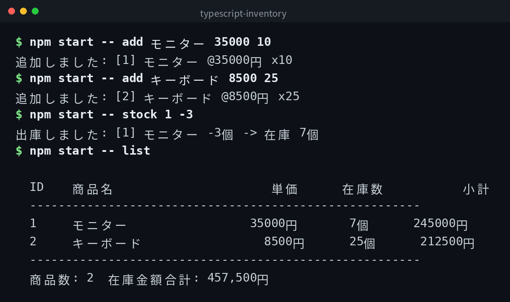

English | [日本語](ja/README.md) | [한국어](ko/README.md)

# typescript-inventory


## Overview

A simple command-line inventory management tool. You can add products, list them, stock in/out, delete products, and view the total inventory value. Data is stored in `inventory.json`.

## Demo



*Actual output. The CLI interface is in Japanese.*

## Features

- Add products with name, unit price, and quantity
- List all products with subtotals and total inventory value
- Stock in (increase) and stock out (decrease) quantities
- Delete products
- Display help for available commands
- No external runtime libraries required

## Requirements

- Node.js 16 or higher
- TypeScript 5.0 or higher (included in devDependencies)

## Quick Start

```bash
git clone https://github.com/mivork/typescript-inventory.git
cd typescript-inventory
npm install
npm run build
npm start -- add モニター 35000 10
npm start -- list
```

## Usage

| Command | Description |
|---|---|
| `add <name> <price> <quantity>` | Add a product |
| `list` | List all products and total inventory value |
| `stock <product ID> <quantity>` | Stock in (positive) or stock out (negative) |
| `delete <product ID>` | Delete a product |
| `help` | Display help |

### Example Output

```

  ID    商品名                単価     在庫数          小計
  -------------------------------------------------------
  1     モニター          35000円      10個      350000円
  2     キーボード         8500円      25個      212500円
  -------------------------------------------------------
  商品数: 2  在庫金額合計: 562,500円

```

## Data Format

Products are stored in `inventory.json` in JSON format.

## Notes

Only `typescript` is included in devDependencies. No external runtime libraries are used.

## License

This project is licensed under the MIT License.
