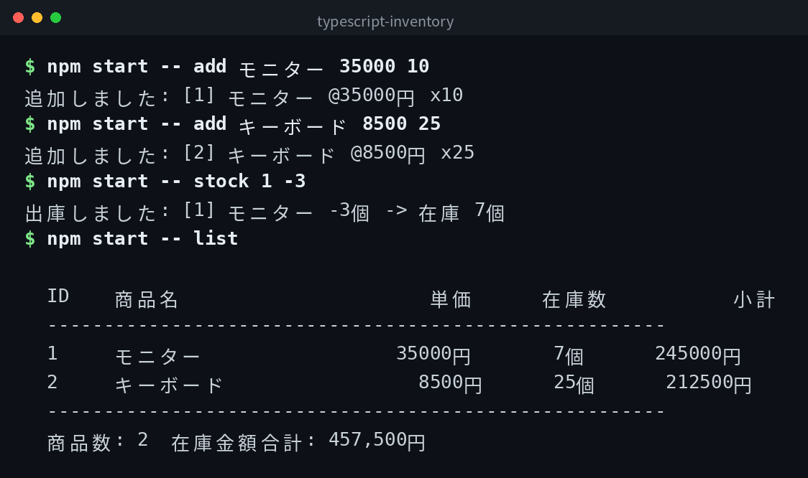

[English](../README.md) | 日本語 | [한국어](../ko/README.md)

# typescript-inventory


## 概要

コマンドラインで動くシンプルな在庫管理ツールです。商品の追加・一覧・入庫・出庫・削除と、在庫金額合計の表示ができます。データは `inventory.json` に保存されます。

## デモ



## Features

- 商品名・単価・数量を指定して商品を追加できる
- 商品一覧と小計・在庫金額合計を表示できる
- 入庫（在庫を増やす）・出庫（在庫を減らす）ができる
- 商品を削除できる
- ヘルプでコマンド一覧を確認できる
- 外部ランタイムライブラリは不要

## 必要環境

- Node.js 16 以上
- TypeScript 5.0 以上（devDependencies に含まれます）

## Quick Start

```bash
git clone https://github.com/mivork/typescript-inventory.git
cd typescript-inventory
npm install
npm run build
npm start -- add モニター 35000 10
npm start -- list
```

## コマンド一覧

| コマンド | 説明 |
|---|---|
| `add <商品名> <単価> <数量>` | 商品を追加する |
| `list` | 商品一覧と在庫金額合計を表示する |
| `stock <商品ID> <数量>` | 入庫（正の数）または出庫（負の数） |
| `delete <商品ID>` | 商品を削除する |
| `help` | ヘルプを表示する |

### 出力例

```

  ID    商品名                単価     在庫数          小計
  -------------------------------------------------------
  1     モニター          35000円      10個      350000円
  2     キーボード         8500円      25個      212500円
  -------------------------------------------------------
  商品数: 2  在庫金額合計: 562,500円

```

## データ形式

商品データは `inventory.json` に JSON 形式で保存されます。

## 補足

`typescript` のみ devDependencies に含まれます。外部ランタイムライブラリは使用していません。

## ライセンス

このプロジェクトは MIT ライセンスの下で公開されています。
