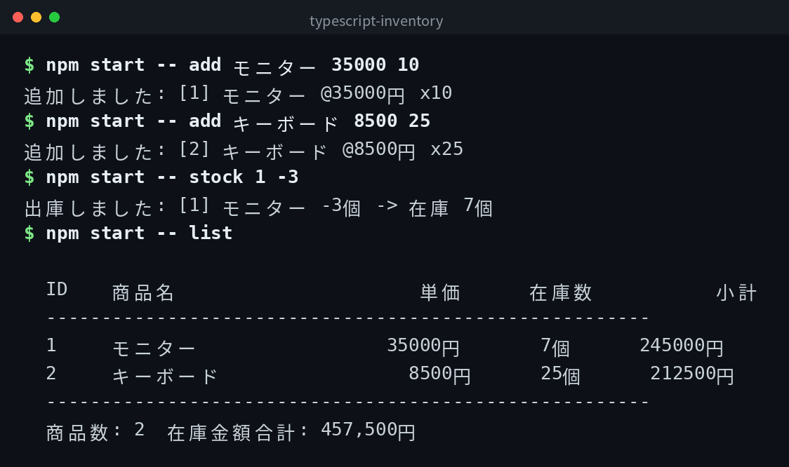

[English](../README.md) | [日本語](../ja/README.md) | 한국어

# typescript-inventory


## 개요

커맨드라인에서 동작하는 간단한 재고 관리 도구입니다. 상품 추가, 목록 표시, 입고, 출고, 삭제 및 재고 금액 합계 표시가 가능합니다. 데이터는 `inventory.json`에 저장됩니다.

## 데모



*실제 출력입니다. CLI 인터페이스는 일본어입니다.*

## Features

- 상품명, 단가, 수량을 지정하여 상품을 추가할 수 있음
- 상품 목록과 소계 및 재고 금액 합계를 표시할 수 있음
- 입고(재고 증가) 및 출고(재고 감소)가 가능함
- 상품을 삭제할 수 있음
- 도움말로 명령어 목록을 확인할 수 있음
- 외부 런타임 라이브러리 불필요

## 필요 환경

- Node.js 16 이상
- TypeScript 5.0 이상 (devDependencies에 포함)

## Quick Start

```bash
git clone https://github.com/mivork/typescript-inventory.git
cd typescript-inventory
npm install
npm run build
npm start -- add モニター 35000 10
npm start -- list
```

## 사용법

| 명령어 | 설명 |
|---|---|
| `add <상품명> <단가> <수량>` | 상품을 추가한다 |
| `list` | 상품 목록과 재고 금액 합계를 표시한다 |
| `stock <상품 ID> <수량>` | 입고(양수) 또는 출고(음수) |
| `delete <상품 ID>` | 상품을 삭제한다 |
| `help` | 도움말을 표시한다 |

### 출력 예시

```

  ID    商品名                単価     在庫数          小計
  -------------------------------------------------------
  1     モニター          35000円      10個      350000円
  2     キーボード         8500円      25個      212500円
  -------------------------------------------------------
  商品数: 2  在庫金額合計: 562,500円

```

## 데이터 형식

상품 데이터는 `inventory.json`에 JSON 형식으로 저장됩니다.

## 참고

`typescript`만 devDependencies에 포함되어 있습니다. 외부 런타임 라이브러리는 사용하지 않습니다.

## 라이선스

이 프로젝트는 MIT 라이선스 하에 공개되어 있습니다.
